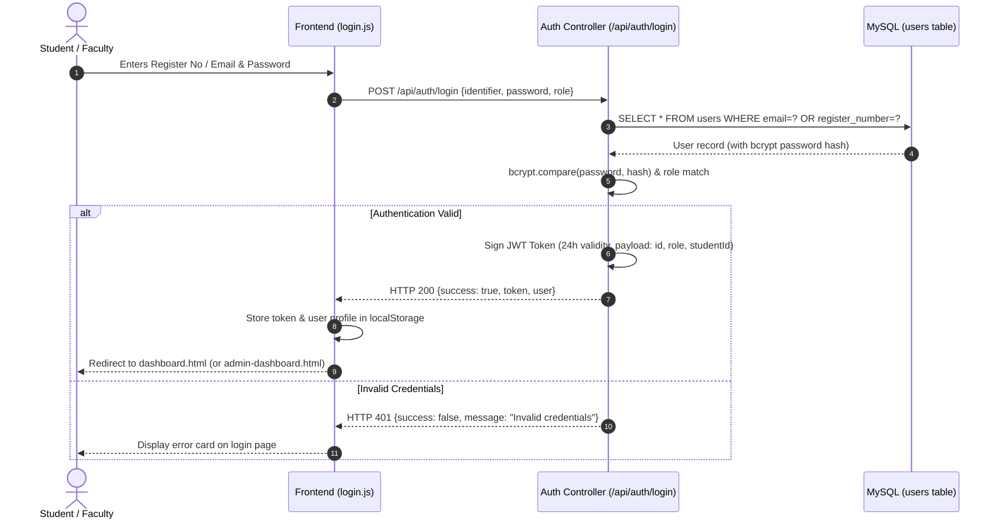
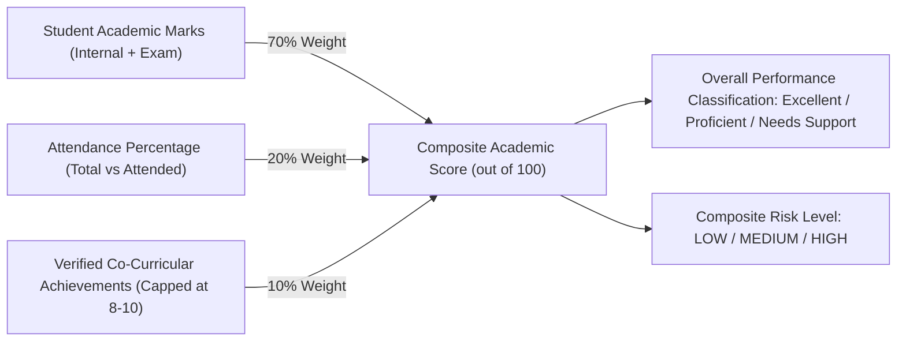

# ATS System Architecture & Data Flow Specification

## 1. High-Level System Architecture

The AI-Based Academic Progress and Achievement Tracking System (ATS) is structured across four decoupled, modular tiers:

```mermaid
flowchart TD
    subgraph ClientTier["Client Presentation Tier (HTML5 / Vanilla JS / Chart.js)"]
        UI_Student["Student Dashboard & Chatbot UI"]
        UI_Admin["Faculty & Admin Console"]
        UI_Auth["Premium SaaS Login Portal"]
    end

    subgraph APITier["Application & REST API Tier (Node.js & Express.js)"]
        Router["Express REST Router (/api)"]
        AuthMiddleware["JWT & Role Authorization Guard"]
        Controllers["Module Controllers (Auth, Student, Marks, Att, Chat, AI)"]
        Router --> AuthMiddleware --> Controllers
    end

    subgraph DataTier["Data Persistence Tier (MySQL 8.x with explicitly reported legacy fallback)"]
        MySQL[("MySQL Database: ats_database")]
        Tables["colleges, departments, programs, academic_years, semesters, grading_rules, attendance_thresholds, users, faculty, students, subjects, subject_allocations, student_subjects, marks, attendance, achievements, certifications, recommendations, risk_alerts, notifications, chat_history"]
        MySQL --- Tables
    end

    subgraph AITier["AI Intelligence & Heuristics Tier (Python 3.12)"]
        AnalysisEngine["Explainable Analytics (analysis.py)"]
        Agent["Academic Monitoring Agent (academic_agent.py)"]
        RecEngine["Recommendation Engine (recommendation.py)"]
        ChatEngine["Contextual NLP Query Engine"]
    end

    UI_Student -->|REST / JSON| Router
    UI_Admin -->|REST / JSON| Router
    UI_Auth -->|REST / JSON| Router

    Controllers -->|SQL Queries (mysql2/promise)| MySQL
    Controllers -->|JSON IPC (child_process)| AnalysisEngine
    Controllers -->|Autonomous Scan| Agent
    Controllers -->|Contextual Reasoning| ChatEngine
```

---

## 2. Authentication Flow



---

## 3. Student Workflow

1. **Dashboard Initialization**:
   - `checkAuth('student')` verifies token in `localStorage`.
   - `GET /api/dashboard/:studentId` returns 5 KPI cards (GPA, Attendance %, Achievements count, Academic Score, Risk Level) and datasets for 4 Chart.js charts.
2. **Performance Review**:
   - Evaluates marks against the 80+ (Strong), 60-79 (Average), <60 (Weak) thresholds.
3. **Attendance Compliance**:
   - Detects subjects with attendance < 75% and displays a critical warning banner with the exact number of consecutive classes required to restore eligibility.
4. **Achievement Verification**:
   - Visualizes verified co-curricular awards, hackathon rankings, and technical certifications.
5. **AI Interaction**:
   - Conversational assistant answers inquiries with real-time academic numbers.

---

## 4. Faculty & Admin Workflow

1. **Class Overview**:
   - `GET /api/dashboard/admin/summary` provides department aggregates (average GPA, average attendance, at-risk count).
2. **Risk Matrix**:
   - Identifies students requiring remediation (students meeting configured academic risk rules) and recommends actions.
3. **Registry Management (`students.html`)**:
   - Enroll new students (`POST /api/students`).
   - Edit student profiles (`PUT /api/students/:id`).
   - Remove student records (`DELETE /api/students/:id`).
4. **Academic Data Entry**:
   - Add/update semester marks (`POST /api/performance`).
   - Log attendance records (`POST /api/attendance`).
5. **Autonomous Monitoring Trigger**:
   - Invokes `academic_agent.py` across student batches to generate updated alerts.

---

## 5. AI Heuristic Analysis & Scoring Engine



- **Explainability**: No unverified or fabricated "black box" claims. The system uses Multi-Criteria Decision Analysis (MCDA), statistical mean/variance calculations, and clear institutional heuristic rules.
- **Fail-Safe Fallback**: If Python is absent or the subprocess fails, the Node.js backend automatically executes an in-process JavaScript analytical fallback so that user dashboards never crash.
